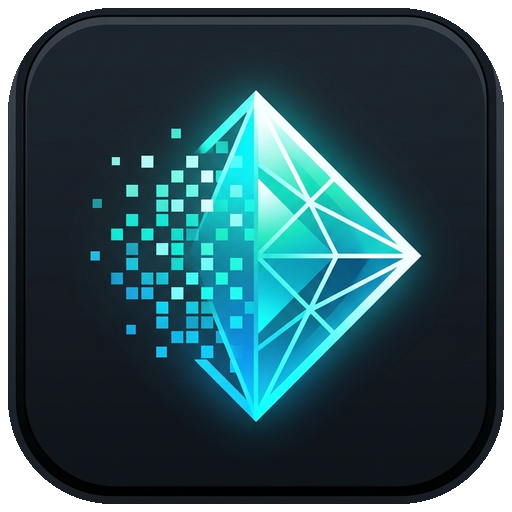

<p align="center">
  
</p>

<h1 align="center">Lumina Upscaler</h1>

<p align="center">
  Lightweight Python CLI & Classic Desktop GUI for <b>Image & Video Quality Enhancement</b><br/>
  Upscaling (1x–8x) • Denoising • Sharpening • Anti-Flicker — Zero CUDA Required
</p>

<p align="center">
  
  
  
</p>

---

## Overview

**Lumina Upscaler** is a lightweight, local image and video upscaler for Windows focused 100% on quality enhancement (upscaling, denoising, sharpening, and anti-flicker — no frame interpolation). It runs on low-VRAM and legacy GPUs via DirectML without needing heavy CUDA toolkits, and scales cleanly to faster hardware.

### Key Features
- **Hardware Accelerated (DirectML / CUDA / CPU):** Runs ONNX super-resolution models on DirectX 12 GPUs (NVIDIA, AMD, and Intel) with automatic multi-core CPU fallback if a legacy driver rejects an op.
- **Smart Tiling Engine:** Overlap padding with raised-cosine feather blending prevents VRAM crashes and eliminates visible tile seams.
- **Unified Photos & Video Pipeline:** EXIF-aware & 16-bit-safe batch image processing, plus FFmpeg RAM-pipe video processing with audio stream copy and accurate BT.709/BT.601 color matrices.
- **Anti-Flicker & Stop/Resume:** Lightweight DIS Optical Flow temporal stabilization to reduce video flickering, plus lossless pause & resume checkpoints.
- **Model Chaining & 1x–8x Scaling:** Optional 2-stage model chaining (e.g. `1x` deblocking → `2x`/`4x` upscaling), quick before/after **Preview**, and externalized JSON presets (`config/presets.json`).

---
## Preview

<p align="center">
  
</p>
---

## Hardware Support

| Hardware | Backend | Notes |
| :--- | :--- | :--- |
| **NVIDIA / AMD GPUs (DX12)** | DirectML / CUDA | Full GPU acceleration. Cards with **1GB–2GB VRAM** work smoothly for photos and **short video clips** (use Pause/Resume for longer clips); higher-VRAM GPUs automatically use larger tiles. |
| **Intel GPUs (Arc / Iris Xe / UHD)** | DirectML | Supported on modern DirectX 12 drivers. Very old integrated Intel GPUs (e.g. HD 4000/4600) may reject some ONNX ops and automatically fall back to CPU. |
| **CPU Only (Intel / AMD)** | Multi-Core CPU | Supported automatically across all available CPU threads. Built-in `anime` mode (Anime4K `.glsl`) also runs on CPU—fast for images, slower for video. |

---

## Installation & Setup

### Option 1: Standalone Windows Release (Recommended)
1. Download **`LuminaUpscaler.zip`** from the [**Releases**](../../releases) page and extract it.
2. Download one or more `.onnx` models from the table below and place them inside the **`models/`** folder.
3. *(For Video mode)* Download a Windows build of FFmpeg from [ffmpeg.org](https://ffmpeg.org/download.html) and place **`ffmpeg.exe`** (and `ffprobe.exe`) inside the **`ffmpeg/`** folder.
4. Double-click **`LuminaUpscaler.exe`**.

### Option 2: Run From Source (Python 3.10–3.12)
```bash
git clone https://github.com/<your-username>/lumina-upscaler.git
cd lumina-upscaler
pip install -r requirements.txt
python gui.py
```
> **Note:** If you already have plain `onnxruntime` installed, run `pip uninstall onnxruntime` before installing `requirements.txt` so it does not conflict with `onnxruntime-directml`.

---

## Recommended Models (Place in `models/`)

| Use Case | Model 1 (Pre / 1x) | Model 2 (Main Upscale) | Scale | License |
| :--- | :--- | :--- | :---: | :--- |
| **General Photos & Video** | `None` | [realesr-general-x4v3 (ONNX)](https://huggingface.co/CoderViking/realesr-general-x4v3-onnx) | 4x | BSD-3-Clause |
| **Live-Action Video** | `None` | [OpenProteus](https://github.com/Sirosky/Upscale-Hub/releases) | 2x | See release page |
| **Anime / Motion Graphics** | `None` | [Ani4K v2](https://github.com/Sirosky/Upscale-Hub/releases/tag/Ani4K-v2) | 2x | CC-BY-NC-4.0 |
| **Anime (Lightweight)** | `None` | [2x AnimeJaNai UltraCompact](https://openmodeldb.info/models/2x-AnimeJaNai-Strong-v1-UltraCompact) | 2x | CC-BY-NC-SA-4.0 |

> Keep **Model 1** set to `None` unless you are running a dedicated `1x` restoration/deblocking model before your main upscaler. Always verify third-party model licenses before commercial use.

---

## Built-in Presets (`config/presets.json`)

| Preset | Best For | Behavior |
| :--- | :--- | :--- |
| **`Pure AI`** | Fastest speed & clean sources | Zero-overhead fast path (all extra filters off, pure model output) |
| **`Anime`** | 2D animation & motion graphics | Light sharpening (`0.10`) + edge dehalo (`0.25`) |
| **`Real`** | Photos & live-action video | Balanced detail recovery, sharpening, subtle luma blend & film grain |
| **`Decompress`** | Heavily compressed web/social footage | Pre-AI denoise & compression cleanup + stronger anti-flicker |

---

## CLI Usage

```bash
# Check detected GPUs, VRAM, and recommended tile size
python cli.py --check-gpu

# Upscale a single image or a folder of images
python cli.py -i photo.jpg -o photo_4x.png --mode real --model realesr-general-x4v3.onnx --scale 4
python cli.py -i input_photos -o output_photos --mode real --model realesr-general-x4v3.onnx --scale 2

# Upscale a video with anti-flicker and original audio
python cli.py -i clip.mp4 -o clip_2x.mp4 --mode real --model OpenProteus.onnx --scale 2 --anti-flicker 0.20 --codec h264 --crf 18
```

---

## Building the Windows `.exe`

Double-click **`build_exe.bat`** in the project root. PyInstaller will package a portable build to `dist/LuminaUpscaler/LuminaUpscaler.exe` with the custom icon (`assets/icon.ico`), `config/presets.json`, `LICENSE`, and `README.md`.

---

## Project Structure

```text
lumina_upscaler/
├── gui.py / cli.py         # Desktop GUI & CLI entry points
├── build_exe.bat           # One-click PyInstaller .exe builder
├── core/                   # Hardware detection, tiling, post-processing, config
├── engines/                # ONNX (DirectML/CUDA/CPU) & Anime4K GLSL engines
├── video/                  # FFmpeg RAM pipes & DIS Optical Flow stabilizer
├── config/                 # presets.json & auto-saved settings.json
├── assets/                 # App logo (logo.png) & Windows icon (icon.ico)
├── shaders/                # Bundled Anime4K .glsl shaders (MIT)
├── models/                 # Place .onnx models here
├── ffmpeg/                 # Place ffmpeg.exe here
└── tests/                  # Automated unit tests (python -m unittest)
```

---

## License & Credits

- **Lumina Upscaler:** [MIT License](LICENSE)
- **Anime4K Shaders:** MIT License (bloc97)
- **Real-ESRGAN:** BSD-3-Clause License (Tencent ARC Lab)
- **ONNX Runtime DirectML:** MIT License (Microsoft)
- **FFmpeg:** LGPL / GPL ([ffmpeg.org](https://ffmpeg.org/))
